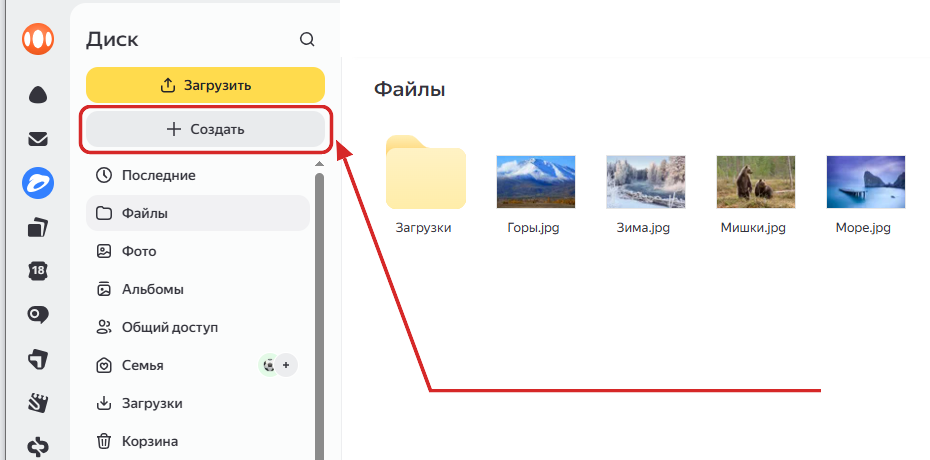
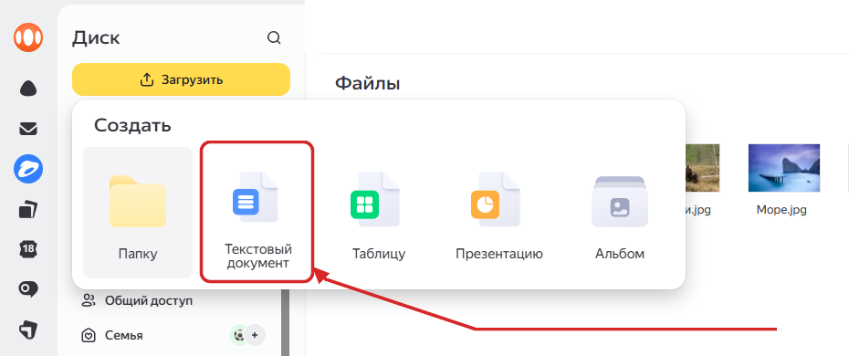
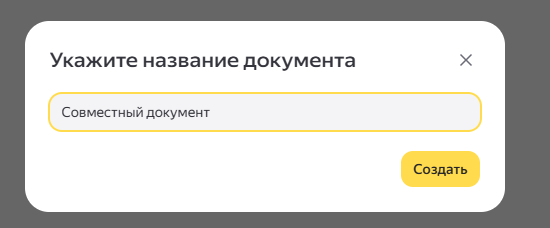
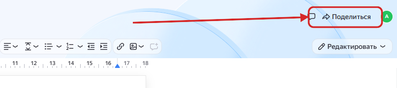
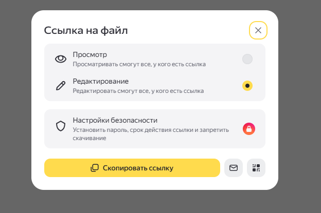
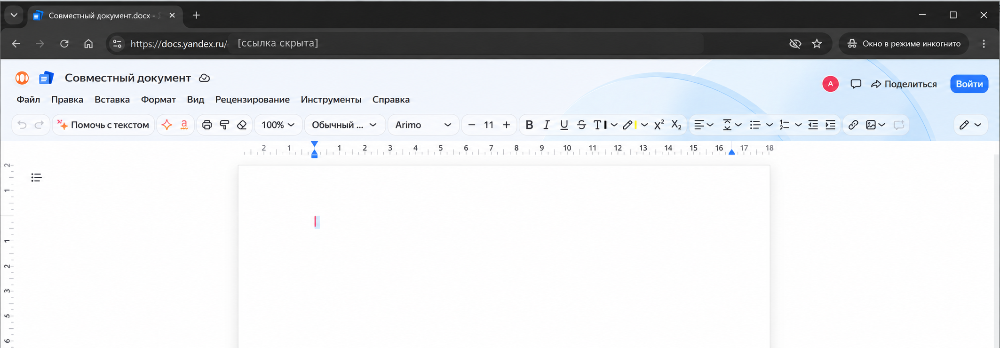

# Как создать документ и настроить совместный доступ в Яндекс Диске

Инструкция описывает создание текстового документа в веб-версии Яндекс Диска, предоставление соавтору прав на редактирование по ссылке и проверку доступа к файлу.

## Перед началом работы

Для выполнения инструкции потребуются:

- учётная запись Яндекса;
- браузер с доступом в интернет;
- возможность открыть новое окно браузера в режиме инкогнито.

## Порядок действий

1. Войдите в Яндекс Диск и нажмите кнопку **«Создать»** на главной странице.

*Рисунок 1 — Кнопка создания нового объекта*

2. Выберите **«Текстовый документ»** в открывшемся меню.

*Рисунок 2 — Создание текстового документа*

3. Введите название документа, например **«Совместный документ»**.

> **Примечание.** В названии файла нельзя использовать символы `\ / : * ? " < >`. Название не должно начинаться с точки или совпадать с названием другого файла в той же папке.

*Рисунок 3 — Ввод названия документа*

4. Нажмите кнопку **«Создать»**.

Документ откроется в редакторе Яндекс Документов.

5. Нажмите кнопку **«Поделиться»** в правой верхней части окна.

*Рисунок 4 — Переход к настройкам совместного доступа*

6. Выберите режим доступа **«Редактирование»** и нажмите кнопку **«Скопировать ссылку»**.

*Рисунок 5 — Предоставление доступа с правами на редактирование*

> **Важно.** Редактировать документ сможет любой пользователь, получивший эту ссылку. Передавайте её только тем, кому доверяете.

> **Настройки безопасности.** В зависимости от используемого тарифа можно установить пароль, ограничить срок действия ссылки и запретить скачивание файла. Ссылка, защищённая паролем, предоставляет доступ только на просмотр и не подходит для совместного редактирования. В этой инструкции дополнительные настройки безопасности не рассматриваются.

7. Передайте скопированную ссылку соавтору.

> **Другие способы передачи ссылки.** Нажмите **значок конверта**, чтобы открыть Яндекс Почту: ссылка на документ будет автоматически добавлена в новое письмо. Нажмите **значок QR-кода**, чтобы сформировать QR-код со ссылкой. Получатель сможет отсканировать его камерой мобильного устройства. QR-код предоставляет те же права, которые установлены для ссылки, поэтому не публикуйте его в открытом доступе.

## Проверка доступа

Для самостоятельной проверки окно браузера в режиме инкогнито используется как имитация перехода соавтора по полученной ссылке.

8. Откройте новое окно браузера в режиме инкогнито.

9. Перейдите в нём по скопированной ссылке.

10. Убедитесь, что документ открылся в режиме редактирования.

*Рисунок 6 — Проверка доступа к документу*

## Результат

Текстовый документ создан в Яндекс Диске. Соавтор, получивший ссылку, может открыть и редактировать файл без входа в учётную запись владельца.
